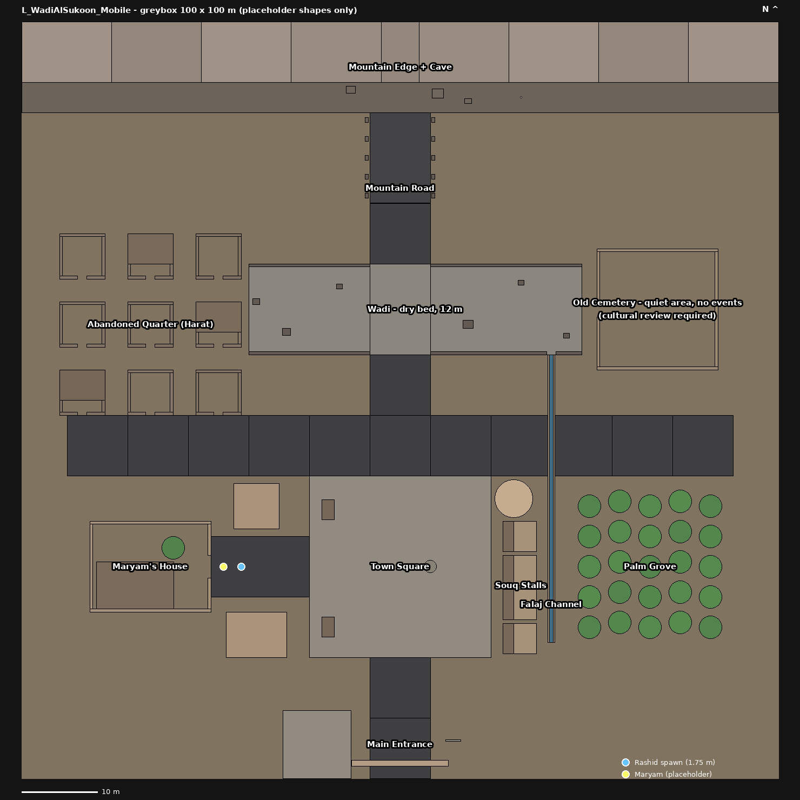

# 04 — Mobile Map & Character Plan (Milestone: Android greybox)

Branch: `design/mobile-map-rashid-maryam` · Engine: Unreal Engine 5.4 (C++) · Target: Android first, iOS kept.

This document adds to `01`–`04_Mobile_Spec_and_Engine_Decision.md`. It does not replace them. The
mystery-investigation concept stays as it is. This milestone adds only the following:

- a **greybox map** with labelled areas
- **two placeholder character positions** (Rashid = player spawn; Maryam = NPC marker)
- Android quality settings

Nothing in it is final art, final architecture or a final character.

*The image is drawn from the same layout data the editor script uses (`python3 Tools/greybox_preview.py`).*

## 1. Repository audit (start of milestone)

| Item | Finding |
|---|---|
| Engine | `EngineAssociation: 5.4`; targets use `BuildSettingsVersion.Latest`. |
| C++ classes | `AOTDGameMode` (default pawn), `AOTDCharacter` (third-person, Enhanced Input built at runtime, sprint/crouch/jump, spring-arm camera with collision), `SOTDTouchControls` (Slate touch buttons). |
| Content | None before this milestone. No `.uasset`, `.umap`, meshes or materials. |
| Build status | **Not compiled.** The cloud workspace this was written in has no Unreal Engine, no Android SDK/NDK and no Windows. The C++ was reviewed by reading it against the UE 5.4 API, and no blocking errors were found. That is not a compile, so treat the build as **unverified** until step 4 below passes on a real machine. |
| Android | Package settings already existed (arm64, Vulkan, landscape). This milestone adds SDK levels, forward shading and device profiles. |

## 2. What changed

| File | Change |
|---|---|
| `Config/DefaultEngine.ini` | Mobile **forward** shading (`r.Mobile.ShadingPath=0`) + MSAA for wide Android GPU support. Lumen, Nanite, virtual shadow maps and distance fields explicitly **off**. `MinSDKVersion=26`, `TargetSDKVersion=34` (verify against your UE 5.4 + Google Play requirements). Default/startup map set to the greybox. |
| `Config/DefaultDeviceProfiles.ini` (new) | Quality presets **Low / Mid / High** on the engine's `Android_Low/Mid/High` profiles: scalability groups 0/1/2, MSAA 1/2/4, shadow resolution 512/1024/2048, **30 / 30 / 60 FPS** caps. |
| `OmanDarkSide.uproject` | Editor-only plugins `PythonScriptPlugin` + `EditorScriptingUtilities` (needed to build the map; not packaged into the game). |
| `Content/Python/otd_greybox_layout.py` (new) | The whole layout as data (pure Python, testable without Unreal) + overlap / spawn self-check. |
| `Content/Python/otd_build_greybox.py` (new) | Editor script: creates and saves `/Game/OTD/Maps/L_WadiAlSukoon_Mobile`. It places engine primitives, labels, lighting, the nav-mesh volume, the player start and the World Settings game mode. |
| `Tools/greybox_preview.py` (new) | Runs the self-check and draws `Docs/Images/greybox_topdown.png`. |

**Why an editor script and not a C++ builder or a hand-made `.umap`?** A `.umap` is a binary file that
only the editor can write. An editor script that places ordinary `StaticMeshActor`s gives you:

- a map designers can edit by hand
- a map that cooks for Android like any other map
- lighting that can be built normally
- **no new C++**, so there is nothing new that could break the compile

## 3. Layout — `L_WadiAlSukoon_Mobile` (fictional, original)

The map is 100 × 100 m. Axes: +X = north, +Y = east. Roads use an 8 × 8 m grid. Every area has a floating text label.

| Row (N→S) | West | Centre | East |
|---|---|---|---|
| 1 | Mountain edge (cliff 12–20 m) with a **cave** at the road's end: 5 m wide, 3.5 m high, 7 m deep. Rockfall and a survey-mast placeholder sit on the 4 m ledge. | | |
| 2 | | **Mountain road**, 8 m wide, 12 m ramp rising 4 m (≈18°, walkable), with guard stones | |
| 3 | **Abandoned quarter (harat)**, 24 × 24 m: 3 × 3 ruined houses, 3 m lanes | **Wadi**, 12 m wide dry bed, low banks, boulders, ford where the road crosses | **Old cemetery** (quiet area): low wall only |
| 4 | **Maryam's house**: 16 × 12 m compound, gate on the east wall, house block, courtyard palm | **Town square**, 24 × 24 m: well, two stall canopies, fort tower at the NE corner, souq stalls on the east side | **Falaj** channel and **palm grove**, 20 × 20 m (25 palms) |
| 5 | | **Main entrance**: gate, sign, parking | |

The **E–W road** runs along the square's north edge and links every part of the map.

**Character positions (placeholders only):**
- **Rashid:** the `PlayerStart` (tag `Rashid`) sits on the lane just outside Maryam's gate, at (-2200, -2100), facing west. Its marker is a 1.75 m cylinder that is hidden in game.
- **Maryam:** a 1.65 m orange marker (tag `OTD.NPC.Maryam`) stands 2.3 m in front of Rashid, facing him. There is no character class yet. That is the next milestone.

**Cultural notes:**
- The cemetery has **no graves modelled and no events**. It is a quiet place only, and it must be checked by an Omani cultural reviewer before any art pass.
- No mosque is used for any story beat.
- Every shape is a placeholder and must not be read as final Omani architecture or clothing.

## 4. How to build and verify (on your machine)

You need Unreal Engine 5.4 and Visual Studio 2022 with the "Game development with C++" workload. For Android you also need Android Studio plus the SDK/NDK version that the UE 5.4 docs list.

1. Right-click `OmanDarkSide.uproject` → **Generate Visual Studio project files**.
2. Open `OmanDarkSide.sln` → **Development Editor | Win64** → Build. **This is the compile check.** Report any error here before going further.
3. Open the project. If it asks to rebuild modules, click **Yes**.
4. **Tools → Execute Python Script…** → `Content/Python/otd_build_greybox.py`.
   - The Output Log should end with: `[OTD greybox] done: 209 shapes, 13 labels, saved /Game/OTD/Maps/L_WadiAlSukoon_Mobile`.
5. Press **Play**. You spawn as the placeholder Rashid outside Maryam's gate. Walk to every label.
6. Android test:
   - **Platforms → Android → Package Project** (ASTC).
   - On the device, force each preset from the console with `dp.Override Android_Low` (then `Android_Mid` / `Android_High`) and check `stat fps`.

If the labels read mirrored, set `LABEL_YAW = 0` in the script and re-run it. Re-running only replaces actors tagged `OTDGreybox`.

## 5. Status of this milestone

| Step | Status |
|---|---|
| A. Verify repo / build | Repo audited. **Build not verified**: no UE or Android SDK in this workspace. |
| B. Inspect C++ / config | Done. No blocking error found by review. |
| C. Fix build blockers | None found. No C++ changed. |
| D. Android/mobile config | Done (config files). Not tested on a device. |
| E. Greybox `L_WadiAlSukoon_Mobile` | Layout + editor script done. The layout self-check passes. The script runs end-to-end against a stand-in for the `unreal` module, but **has not run in a real editor yet**. |
| F. Compile + report | **Pending on a machine with UE 5.4.** Do not start the next milestone until steps 2 and 4 of section 4 succeed. |

## 6. Next milestones (not started)

1. **Rashid character:**
   - Placeholder mesh, then a licensed or original model.
   - Optional first-person camera toggle.
   - Tuning variables exposed.
2. **`AOTDMaryamCharacter` NPC:** idle at the marker, interaction prompt, placeholder dialogue lines. Ambiguous and family-safe tone.
3. **Modular architecture kit:**
   - Wall, gate, roof, window and stair pieces sized to this grid.
   - Reviewed for cultural accuracy.
   - Licences documented for every asset.
4. **First lighting and atmosphere pass** on mobile (performance budgets per device profile).
