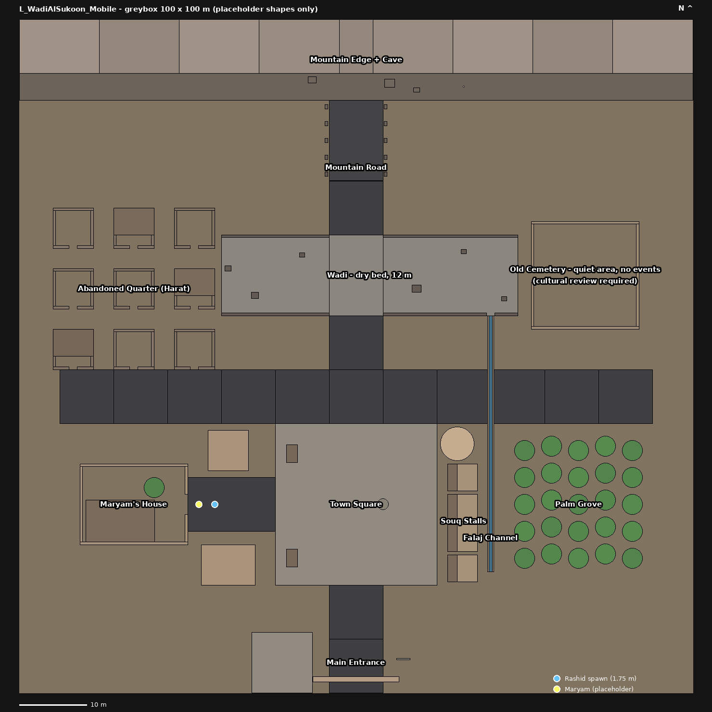

# OMAN: THE DARK SIDE

An original, family-friendly Omani mystery and investigation game. The player follows clues, talks to people
and solves a case. There is no combat. Anything supernatural stays ambiguous.

## What is in this repository

| Part | Where | State |
|---|---|---|
| Unreal Engine 5.4 C++ project (mobile: Android first, iOS kept) | `OmanDarkSide.uproject`, `Source/`, `Config/` | Third-person character, touch controls. **Not yet compiled on a real machine.** |
| Greybox map `L_WadiAlSukoon_Mobile` | `Content/Python/` (built by an editor script) | Layout done and self-checked. Must be generated once in the editor. |
| Design documents | `Docs/01` … `Docs/04_*` | Up to date |
| Playable web prototypes (case 1, film, walkable harat) | `website/` | Published with GitHub Pages |

## Current milestone — Android greybox (branch `design/mobile-map-rashid-maryam`)

- Android settings:
  - Low / Mid / High quality presets (30 / 30 / 60 FPS)
  - mobile forward shading
  - no Lumen or Nanite
- A 100 × 100 m greybox made of engine primitives, with every area labelled:
  - entrance, town square and souq
  - Maryam's house
  - falaj and palm grove
  - wadi and abandoned harat
  - quiet old cemetery
  - mountain road and cave
- Two placeholder character positions: Rashid (player spawn) and Maryam (NPC marker).

Full details, layout and build steps: [Docs/04_Mobile_Map_Character_Plan.md](Docs/04_Mobile_Map_Character_Plan.md)

### Quick start (Windows + UE 5.4)

1. Right-click `OmanDarkSide.uproject` → *Generate Visual Studio project files*. Build **Development Editor | Win64**.
2. Open the project → *Tools → Execute Python Script…* → `Content/Python/otd_build_greybox.py`.
3. Press **Play**.

Check the layout without Unreal: `python3 Tools/greybox_preview.py` (needs Pillow).

## Ground rules

- Every location and character is original and fictional. Nothing here copies real maps, games, brands or real people.
- Placeholder shapes, clothing and architecture are not culturally final. They need review by an Omani cultural advisor.
- Only assets with documented licences may be added.
